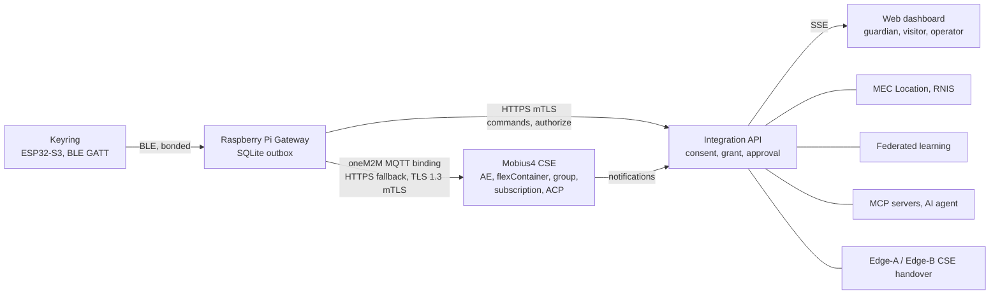

# Privacy Bubble Keyring

A family safety keyring that keeps location private by default, built on the
oneM2M standard IoT service layer.

Code: Apache-2.0 | Docs, media and hardware design: CC BY 4.0 | oneM2M CSE: Mobius4 4.24.5 | 2026 oneM2M International Hackathon

## Purpose

Location trackers for children and older relatives usually upload a precise
position all the time and let every connected app read it. Privacy Bubble
Keyring turns this around. A small BLE keyring (ESP32-S3) reports only presence,
buttons, battery and motion to a nearby Raspberry Pi Gateway. The Gateway
publishes these observations as oneM2M resources in a Mobius4 CSE. Precise
location stays encrypted and opens only when a guardian approves a specific
incident, for a named recipient, for a few minutes. Every command to the
keyring (for example a vibration alert) needs a current consent and grant, and
counts as done only after the device reports a readback of its output. oneM2M
Group, Subscription, accessControlPolicy (ACP) and SDT give the guardian app,
the operator console, the MEC location service, federated learning and an AI
agent one shared, access-controlled data model.

- Why we chose oneM2M and how each feature is used: [docs/oneM2M-why.md](docs/oneM2M-why.md)
- Architecture diagrams, resource tree, command sequence, protocols: [docs/architecture.md](docs/architecture.md)

## Links

| Item | Link |
|---|---|
| Hackster article | TBD (added on publication) |
| Video (under 5 minutes) | TBD (added on publication) |
| Source repository | https://github.com/tirofina/bubble_lock |
| oneM2M | https://www.onem2m.org |
| oneM2M published specifications | https://www.onem2m.org/technical/published-specifications |
| oneM2M Recipes for developers | https://recipes.onem2m.org |
| Mobius4 oneM2M CSE (KETI) | https://github.com/IoTKETI/mobius4 |

## Architecture



| oneM2M feature | Use in this project |
|---|---|
| Group and fanOutPoint | One UPDATE reaches every member keyring; one aggregated response with a result per member |
| Subscription and notification | Receipts and state changes reach the central service and dashboards without polling |
| accessControlPolicy | Each role (guardian, visitor, relay, MEC interworking, executor, operator) holds only the operations it needs |
| SDT (TS-0023) and flexContainer | Keyring state is a standard `binarySwitch` ModuleClass, found by `cnd` discovery |
| container and contentInstance | Immutable observations, command receipts and health frames from the Gateway |
| HTTP and MQTT bindings | Same oneM2M primitive over MQTT with HTTPS fallback, correlated by request identifier |


## Hardware

| Part | Details | Docs |
|---|---|---|
| Keyring PCB r18 | 4-layer hand-solder board, KiCad 10 project. ESP32-S3-WROOM-1-N16R8 (16 MB flash, 8 MB PSRAM), confirm and panic buttons, LIS2DW12 accelerometer, MAX17048 fuel gauge, INA219 supply monitor, BQ24074 charger with TLV6700 temperature gate, vibration motor, MAX98357A speaker amplifier, MAX9850 headphone DAC, microSD, optional ST7789 1.54 inch or JD9853 2.01 inch LCD | [keyring/pcb](keyring/pcb/README.md), [hardware to firmware map](keyring/pcb/HARDWARE_FIRMWARE_MAP.md), [bring-up](keyring/pcb/BRING_UP.md) |
| Bench keyring | Adafruit Feather ESP32 V2 with a 1.54 inch ST7789 display and two buttons; runs the observation and command bench profiles while the r18 boards are assembled | [feather_probe](keyring/firmware/feather_probe/README.md) |
| Gateway | Raspberry Pi with BlueZ (tested on a Pi Zero 2 W, Debian 13, Python 3.13) | [raspberry-pi-gateway](keyring/raspberry-pi-gateway/README.md) |
| Central server | Any Windows or Linux host for Mobius4, PostgreSQL with PostGIS, an MQTT broker and the Node.js services | [pc-mobius](pc-mobius/README.md) |

Firmware build profiles (PlatformIO, `keyring/firmware/platformio.ini`):

| Environment | Purpose |
|---|---|
| `keyring_r18` (default) | Provisioned device firmware for the r18 board |
| `keyring_r18_bringup` | First power-on: observations only, outputs and journal disabled |
| `keyring_compile_minimal`, `keyring_compile_st7789`, `keyring_compile_jd9853`, `keyring_compile_headphone` | Compile matrix with public defaults (`KEYRING_IGNORE_PROVISIONING`), never flashed |

Details and recorded build results: [BUILD_PROFILES.md](keyring/firmware/BUILD_PROFILES.md).

## Repository map

| Path | Contents |
|---|---|
| [`pc-mobius/`](pc-mobius/README.md) | Central Node.js package. CORE oneM2M harness and the integration service |
| [`pc-mobius/src/`](pc-mobius/src) | GatewayBridge (telemetry to flexContainer, ACK binding), GroupDispatcher (fan-out), SDT adapter, receipt journal |
| [`pc-mobius/integration/`](pc-mobius/integration/README.md) | Integration service docs: Gateway registration, CSE security, MEC, FL, MCP, PostgreSQL, location privacy, retention, edge deployment |
| [`pc-mobius/integration/src/`](pc-mobius/integration/src) | API server, policy and portal services, Gateway control, MEC adapter, handover coordinator, FL coordinator and worker, MCP servers |
| [`pc-mobius/contracts/`](pc-mobius/contracts) | CORE oneM2M wire contracts (v1 and canonical v2), integration, portal, MCP and Gateway contracts |
| [`pc-mobius/specializations/`](pc-mobius/specializations) | TS-0023 binarySwitch XSD, oneM2M TS-0004 common types, lineage with SHA-256 |
| [`pc-mobius/scripts/`](pc-mobius/scripts) | Contract runner, bridge, demo, real-CSE runners (`run-*-real.mjs`), FL and MCP verification, Mobius4 security patch |
| [`pc-mobius/config/`](pc-mobius/config) | Example configs: integration API, PostgreSQL, FL worker, edge agent, MCP, Gateway registration, Mobius4 test env |
| [`pc-mobius/db/migrations/`](pc-mobius/db/migrations) | PostgreSQL schema for receipts, policy state and runtime transactions |
| [`pc-mobius/test/`](pc-mobius/test) | Node test suites for CORE and integration |
| [`keyring/`](keyring/README.md) | Device side: firmware, PCB, Gateway, dev CSE stack, evidence |
| [`keyring/firmware/`](keyring/firmware/README.md) | ESP32-S3 firmware (`src/`, `include/`), host tests (`tests/`, `test/`), Feather bench (`feather_probe/`) |
| [`keyring/pcb/r18/`](keyring/pcb/r18/README.md) | KiCad schematic, PCB, footprints, 3D models, BOM and pinout tables |
| [`keyring/raspberry-pi-gateway/`](keyring/raspberry-pi-gateway/README.md) | Python Gateway daemon (`src/bubble_gateway/`), systemd unit and D-Bus policy (`deploy/`), tests |
| [`keyring/dev/mobius4/`](keyring/dev/mobius4/README.md) | Docker Compose dev stack: Mobius4, PostGIS, Mosquitto, TLS 1.3 proxy |
| [`keyring/integration-candidate/`](keyring/integration-candidate/README.md) | Receipt notification ingress, settlement and ordering modules for the central service |
| [`keyring/evidence/`](keyring/evidence) | Dated hardware and integration evidence with logs and SHA-256 |
| [`contracts/keyring/`](contracts/keyring/README.md) | JSON Schema 2020-12 contracts shared by firmware and Gateway |
| [`web-dashboard/`](web-dashboard/README.md) | React and Vite dashboard (`src/`), SSE and OIDC BFF server (`server/`), shared types (`shared/`), event contract (`contracts/`) |
| [`tests/integration/`](tests/integration) | Cross-runtime tests: Python and Node TLS 1.3 mTLS, OIDC, Gateway API, FL worker, edge deployment |
| [`scripts/workspace.mjs`](scripts/workspace.mjs) | Root `setup`, `test` and `verify` runner |
| [`docs/`](docs) | Architecture, oneM2M rationale, verification logs and evidence, integration and handoff notes |

## Prerequisites

| Tool | Version | Needed for |
|---|---|---|
| Node.js | 22.19 or newer | Everything (root `engines`) |
| Python | 3.12 recommended (3.11 or newer) | Gateway, cross-runtime tests, XSD closure. On Windows use `py -3` |
| OpenSSL | on `PATH`, or set `KEYRING_TEST_OPENSSL` | TLS and mTLS tests |
| Git | any recent | Clone with `core.autocrlf=false` on Windows (see Quick start) |
| Mobius4 | 4.24.5 checkout, path in `MOBIUS4_ROOT` | Real-CSE runs |
| PostgreSQL + PostGIS | PostgreSQL 17, PostGIS 3.x | Mobius4 and the PostgreSQL policy store |
| Docker Desktop | optional | Mobius4 Docker Compose profile and `keyring/dev/mobius4` |
| PlatformIO Core | 6.1 or newer (espressif32 6.9.0, Arduino 2.0.17) | r18 firmware |
| Arduino CLI | 1.4.1 with ESP32 Arduino core 3.3.x | Feather bench sketch |
| Zig | 0.13.0, optional | MAX9850 host test (`keyring/firmware/test/run_headphone_host.py`) |

## Quick start

Run these from the repository root. On Windows, clone with LF line endings so
that the oneM2M XSD hashes match, and point `PYTHON` at a real interpreter.

```powershell
git clone -c core.autocrlf=false https://github.com/tirofina/bubble_lock
cd bubble_lock
$env:PYTHON = (py -3 -c "import sys; print(sys.executable)")   # Windows; on Linux use: export PYTHON=python3
npm run setup     # npm ci for pc-mobius and web-dashboard, .venv with the Gateway and test packages
npm test          # CORE, web and Gateway unit tests plus cross-runtime TLS tests
npm run verify    # test + XSD closure, contracts, oneM2M dry-run, integration demo and replay, web build
```

`npm run verify` writes each step log and its SHA-256 to
`.local/verification/verify/results.json`.

Run the demo in three terminals:

```powershell
npm run demo                  # consent, grant, MEC callback, handover, FL, MCP; writes pc-mobius/receipts/
$env:RECEIPT_FILE = (Resolve-Path 'pc-mobius/receipts/integration-demo.jsonl').Path
npm run events                # SSE event server on 127.0.0.1:4174, replays the receipts
npm run dashboard             # http://127.0.0.1:5173
```

- Landing page: `http://127.0.0.1:5173/`
- Guardian map: `http://127.0.0.1:5173/#/user/map`
- Operator console: `http://127.0.0.1:5173/#/operator/overview`

The default dashboard runs in a labelled demo mode with simulated observations.
Real sign-in uses OIDC ([oidc-session.md](web-dashboard/docs/oidc-session.md)).

Start the central API for Gateways (TLS 1.3 and mTLS, port 8787):

```powershell
Copy-Item pc-mobius/config/integration-api.example.json .local/integration-api.json   # then fill in certificates and enrollments
$env:PRIVACY_BUBBLE_API_CONFIG = (Resolve-Path '.local/integration-api.json').Path
npm run api
```

Without TLS settings the API serves `/healthz` only.

### Package scripts in `pc-mobius`

Run with `npm --prefix pc-mobius run <script>` or from inside `pc-mobius/`.

| Script | Action |
|---|---|
| `test` | Node test suites |
| `validate`, `dry-run` | Validate the oneM2M contract, print requests and receipts without a CSE |
| `prepare-specialization` | Register the binarySwitch flexContainer specialization in a Mobius4 config |
| `bridge` | Run GatewayBridge between the MQTT broker and Mobius4 |
| `integration`, `integration:validate`, `integration:evidence`, `integration:replay` | Integration demo, contract check, evidence manifest, receipt replay |
| `integration:api` | Central API server |
| `integration:mec` | MEC discovery, query, subscription CRUD and callback run against the local MEC provider simulator |
| `fl:verify`, `fl:worker`, `fl:cse` | FL multi-round run, FL worker process, FL publication to a real CSE |
| `mcp:servers`, `mcp:verify` | Start the three MCP servers, run the MCP wire tests |
| `release-manifest`, `replay-receipt` | Build the release manifest, replay a stored receipt |

## Running against a real Mobius4 CSE

1. Get Mobius4 4.24.5 and install its dependencies:

   ```powershell
   git clone https://github.com/IoTKETI/mobius4
   git -C mobius4 checkout v4.24.5
   npm --prefix mobius4 ci
   $env:MOBIUS4_ROOT = (Resolve-Path mobius4).Path
   ```

2. For the source-mode CSE and the two-CSE runners, run PostgreSQL 17 with
   PostGIS and write `.local/postgres/connection.json` with `host`, `port`,
   `user`, `password` and `database`
   ([PostgreSQL notes](pc-mobius/integration/POSTGRES.md)). The Docker profile of
   Mobius4 brings its own PostGIS container.

3. Single CSE, CORE contract (AE, flexContainer, subscription, discovery, group fan-out, readback):

   ```powershell
   node pc-mobius/scripts/prepare-specialization.mjs --mobius-root $env:MOBIUS4_ROOT
   ./pc-mobius/scripts/start-mobius4-test.ps1 -Mobius4Root $env:MOBIUS4_ROOT   # add -Mode source to skip Docker
   node pc-mobius/scripts/run-contract.mjs                                       # second terminal
   ```

4. Two CSEs (Edge-A and Edge-B) for handover, SDT interoperability, ACP and location privacy:

   ```powershell
   node pc-mobius/scripts/run-handover-real.mjs --keep-running   # starts two CSEs, writes .local/handover-cse/current.json
   node pc-mobius/scripts/run-interop-real.mjs                   # second terminal, reads current.json
   node pc-mobius/scripts/run-acp-real.mjs
   node pc-mobius/scripts/run-location-privacy-real.mjs
   ```

   `node pc-mobius/scripts/run-acp-isolated.mjs` runs the ACP and location
   privacy checks on two fresh CSEs with the subscription security patch
   ([CSE security](pc-mobius/integration/CSE_SECURITY.md)). Receipts land in
   `pc-mobius/receipts/`.

5. FL publication to a real CSE: `npm --prefix pc-mobius run fl:cse -- --config=<path to cse-edges.json from current.json>`.

## Deployment

### Raspberry Pi Gateway

The full procedure is in [keyring/raspberry-pi-gateway/README.md](keyring/raspberry-pi-gateway/README.md). In short:

```sh
sudo apt install python3 python3-venv bluez dbus
sudo useradd --system --user-group --home-dir /var/lib/privacy-bubble-gateway --no-create-home --shell /usr/sbin/nologin bubble-gateway
sudo install -d -o root -g root -m 0755 /opt/bubble_lock
sudo cp -a ./bubble_lock/. /opt/bubble_lock/
GW=/opt/bubble_lock/keyring/raspberry-pi-gateway
sudo python3 -m venv $GW/.venv
sudo $GW/.venv/bin/python -m pip install $GW
sudo install -d -o root -g bubble-gateway -m 0750 /etc/privacy-bubble /etc/privacy-bubble/tls
sudo install -o root -g bubble-gateway -m 0640 $GW/.env.example /etc/privacy-bubble/gateway.env
# copy the issued ca.pem, client.pem and client.key into /etc/privacy-bubble/tls (mode 0640)
# replace every REPLACE_* value in gateway.env, then pair each keyring with bluetoothctl
sudo install -o root -g root -m 0644 $GW/deploy/org.bluez.keyring.conf /etc/dbus-1/system.d/org.bluez.keyring.conf
sudo systemctl reload dbus
sudo -u bubble-gateway env STATE_DIRECTORY=/var/lib/privacy-bubble-gateway $GW/.venv/bin/bubble-gateway --env-file /etc/privacy-bubble/gateway.env --check-config
sudo install -o root -g root -m 0644 $GW/deploy/privacy-bubble-gateway.service /etc/systemd/system/privacy-bubble-gateway.service
sudo systemctl daemon-reload
sudo systemctl enable --now privacy-bubble-gateway.service
```

The unit runs as the `bubble-gateway` user with `ProtectSystem=strict`, one
writable state directory (`/var/lib/privacy-bubble-gateway`) and
`--check-config` before every start.

### Keyring firmware

Copy `keyring/firmware/include/provisioning.example.h` to `provisioning.h`, set
a per-device passkey, then build and flash with PlatformIO
(`pio run -e keyring_r18 -t upload`). See
[keyring/firmware/README.md](keyring/firmware/README.md) and
[BRING_UP.md](keyring/pcb/BRING_UP.md).

### Central server

1. Mobius4 with PostgreSQL and PostGIS, the binarySwitch specialization
   (`prepare-specialization`) and the subscription security patch
   (`node pc-mobius/scripts/apply-mobius-security.mjs --mobius-root=<path>`).
2. An MQTT broker with TLS 1.3, client certificates and per-Gateway topic ACLs.
   `keyring/dev/mobius4/` holds a Docker Compose reference with Mosquitto and a
   TLS proxy.
3. The integration API with `PRIVACY_BUBBLE_API_CONFIG`
   ([example](pc-mobius/config/integration-api.example.json)) and the PostgreSQL
   store ([example](pc-mobius/config/postgres.example.json)). Gateway enrollment
   and certificate issuance follow [GATEWAY_REGISTRATION.md](pc-mobius/integration/GATEWAY_REGISTRATION.md).
4. The web dashboard: `npm --prefix web-dashboard run build`, served with the
   OIDC BFF configured by `PORTAL_CONFIG_FILE` ([oidc-session.md](web-dashboard/docs/oidc-session.md)).
5. Optional edge hosts for handover: [EDGE_DEPLOYMENT.md](pc-mobius/integration/EDGE_DEPLOYMENT.md).

Keep certificates, private keys, passkeys, SQLite databases and runtime state
in git-ignored paths (`.local/`, `.venv/`, `/etc/privacy-bubble/`).

## Verification status

Three levels are kept apart: implemented (code in this repository), locally
verified (real processes, TLS, databases and CSEs on a development host), and
hardware verified (real keyring board or bench board and a real Raspberry Pi).

| Capability | Implemented | Locally verified | Hardware verified |
|---|---|---|---|
| Full test and build suite | Yes | `npm run verify` 13 steps PASS, 386 tests on 2026-11-11 ([logs](docs/verification/2026-11-11/results.json)) | n/a |
| oneM2M CORE contract: AE, flexContainer, subscription, discovery, group fopt, readback | Yes | Contract and dry-run in verify; two real Mobius4 CSEs times two clients ([interop](docs/verification-evidence/2026-11-11/interop-real-cse.json)) | n/a |
| ACP role matrix and subscription security patch | Yes | 828 cases PASS on two real CSEs ([acp](docs/verification-evidence/2026-11-11/acp-real-cse.json)) | n/a |
| SDT binarySwitch and XSD import closure | Yes | XSD closure and canonical contract in verify | n/a |
| Gateway observations to CSE over MQTT with HTTPS fallback | Yes | Gateway tests, MQTT and HTTPS TLS 1.3 wire tests | Pi Zero 2 W with Feather bench: 35 observations stored and read back, broker outage fallback ([pi-cse](keyring/evidence/2026-11-10-pi-cse/README.md)); full daemon run ([pi-full-daemon](keyring/evidence/2026-11-10-pi-full-daemon/README.md)) |
| Approved command with claim, grant revision, epoch, deadline, ACK and readback | Yes | Central API with mock GATT ([central-dispatch](keyring/evidence/2026-11-10-central-dispatch/README.md)) | Feather bench LED ON and OFF with GPIO readback, settled through the CSE notification ([receipt](keyring/evidence/2026-11-11-scoped-feather-led/receipt.json)) |
| r18 keyring firmware | Yes | Four compile profiles and host mock tests ([BUILD_PROFILES](keyring/firmware/BUILD_PROFILES.md)) | r18 board bring-up pending ([BRING_UP](keyring/pcb/BRING_UP.md)) |
| TLS 1.3 mTLS between Python and Node, OIDC token checks | Yes | Cross-runtime tests in verify | External OIDC provider pending |
| Web dashboard (guardian, visitor, operator) | Yes | Build in verify, browser checks ([ui-evidence](docs/ui-evidence/2026-11-10/browser-verification.json)) | Uses demo or replayed receipts |
| CSE handover Edge-A to Edge-B | Yes | Two real CSEs and two edge agents on one host ([handover](docs/verification-evidence/2026-11-11/handover-real-cse.json), [edge](docs/verification-evidence/2026-11-11/edge-deployment-verification-7.json)) | Separate edge hosts pending |
| MEC Location and RNIS adapter | Yes | Local MEC provider simulator, `simulation: true` ([MEC notes](pc-mobius/integration/MEC.md)) | External MEC sandbox pending |
| Federated learning | Yes | `LOCAL_SIMULATION`: 3 seeds times 10 rounds, worker processes over mTLS, publication to a real CSE ([fl-cse](docs/verification-evidence/2026-11-11/fl-cse-verification-6.json)) | ESTIMED VM deployment pending |
| MCP servers (oneM2M, MEC, Audit) | Yes | Wire tests ([mcp](docs/verification-evidence/2026-11-11/mcp-verification-8.json)) | n/a |
| PostgreSQL policy store | Yes | PostgreSQL 17 multi-process runs ([postgres](docs/verification-evidence/2026-11-11/postgres-9.json)) | n/a |
| Precise location privacy | Yes | Real CSE with simulated observations ([location](docs/verification-evidence/2026-11-11/location-privacy-real-cse.json)) | Pending |

Open external checks are tracked in [docs/external-validation-todo.md](docs/external-validation-todo.md).

### Work packages in progress (2026-11-19)

Results and evidence for these packages will be linked here at merge
(`docs/rubric-work/`, `docs/verification-evidence/2026-11-19/`).

| Package | Scope | Results |
|---|---|---|
| R10 | mTLS identity bound to oneM2M ACP originators | TBD |
| R01 / R11 | Group fan-out and an SDT Python client | TBD |
| R12 | Automated handover metrics | TBD |
| R14 | Federated learning over oneM2M resources | TBD |
| R17 | LLM agent over the three MCP servers | TBD |
| R15 / R16 | MEC bridge AE as a oneM2M IPE | TBD |
| R03 | Several applications on one live CSE | TBD |
| R02 | Protocol matrix per segment | TBD |

## Korean documents (한국어 문서)

이 저장소의 세부 설계와 실행 기록은 한국어로 작성되어 있음.

- 개발 완료 기록: [docs/development-completion.md](docs/development-completion.md)
- 통합 계약과 재현 절차: [docs/branch-integration.md](docs/branch-integration.md)
- CORE oneM2M 하니스: [pc-mobius/README.md](pc-mobius/README.md)
- 통합 서비스: [pc-mobius/integration/README.md](pc-mobius/integration/README.md)
- 키링과 Gateway: [keyring/README.md](keyring/README.md)
- 웹 대시보드: [web-dashboard/README.md](web-dashboard/README.md)

## License

- Source code: [Apache License 2.0](LICENSE)
- Documentation, images, media, evidence and hardware design files authored by
  the project: [CC BY 4.0](LICENSE-docs) (https://creativecommons.org/licenses/by/4.0/)
- Third-party material (oneM2M XSD schemas, KiCad library parts, supplier CAD
  models, Mobius4 excerpts) keeps its own terms: see [NOTICE](NOTICE)

## Team and contact

Team "Even Bubble lock is rock", 2026 oneM2M International Hackathon. The work
is split into four roles: PC-MOBIUS-CORE (oneM2M resources, SDT, Group,
bindings), PC-MOBIUS-INTEGRATION (API, policy, MEC, handover, FL, MCP), KEYRING
(firmware, PCB, Raspberry Pi Gateway) and WEB-DASHBOARD (guardian and operator
apps).

Team members: TBD (added by the team on publication).

Questions and feedback: please open an issue at
https://github.com/tirofina/bubble_lock/issues.
