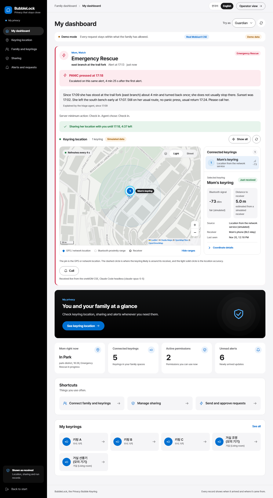
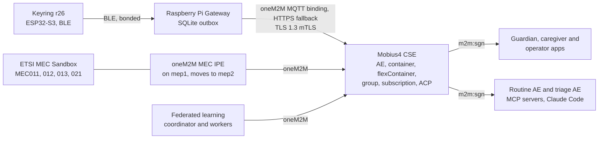

# Privacy Bubble Keyring


*The keyring's family story, pages 1 and 2.*

**Privacy by default. Help before the button.** A BLE keyring for an older parent who lives alone, built on the [oneM2M](https://www.onem2m.org) service layer and ETSI MEC.

Mobius4 oneM2M CSE (4.24.5 in test runs, 4.25.0 on the team server) | ETSI MEC Sandbox | Code Apache-2.0 | Docs and hardware CC BY 4.0 | 2026 oneM2M International Hackathon

| | |
|---|---|
| Hackster.io project | [Privacy Bubble: Help Before the Button](https://www.hackster.io/even-bubble-lock-is-rock/privacy-bubble-help-before-the-button-601c1d) |
| Demo video (under 5 minutes) | [Mom, Where Are You? on YouTube](https://www.youtube.com/watch?v=vOgl1aOGWl0) |
| Why oneM2M, feature by feature | [docs/oneM2M-why.md](docs/oneM2M-why.md) |
| Architecture, resource tree, protocols | [docs/architecture.md](docs/architecture.md) |

## What it does

A resident carries the keyring, her daughter acts as guardian, and a caregiver visits in the afternoon. The oneM2M CSE stores shared data and enforces access for every app. The integration service adds grants, consent and approvals. Together they enforce four rules:

1. **Presence by default.** The keyring reports presence and button presses over BLE to a Raspberry Pi Gateway, which writes them to the CSE. The guardian sees one coarse status: At Home, Moving or In Park.
2. **Devices on grant.** A command requires an active, time-bounded grant and completes when the device reports a matching readback of its physical output.
3. **Help before the button.** A routine model learns her usual walks. On an unusual evening, a Claude triage agent sends the guardian a check-in message before the resident presses PANIC.
4. **Location on approval.** Precise location remains encrypted and becomes visible to one recipient for one incident, for up to five minutes.


*The guardian's alert card shows the triage agent's 17:13 check-in, the PANIC press escalating the same alert at 17:18, and a five-minute location share. Captured live from a real Mobius4 CSE with simulated device positions.*

## Architecture



| oneM2M feature | Use here |
|---|---|
| accessControlPolicy | Every app, the MEC IPE and the AI agent are originators with narrow rights; each client certificate maps to one originator |
| Subscription and notification | One write notifies every subscribed app |
| Group and fanOutPoint | One UPDATE reaches every member keyring, with a result per member |
| SDT (TS-0023) and flexContainer | Device state is a `binarySwitch` (`cod:binSh`), found by `cnd` discovery |
| container and contentInstance | Immutable observations, receipts and incidents with an expiry |
| IPE | MEC013 Location, MEC012 RNIS and MEC021 events become oneM2M resources |

We map the edge layout to deployment option B of oneM2M TR-0077: the CSE and the MEC platform run on separate edge nodes.

## Results

Every local run uses real Mobius4 4.24.5 processes; the team server runs Mobius4 4.25.0. Every receipt identifies its simulated components. `npm run verify` passes 13 steps with 488 tests ([log](docs/verification/2026-11-20/results.json)).

| What | Result | Setup | Receipt |
|---|---|---|---|
| Keyring → Pi → Mobius4 | 35 real BLE observations stored and read back; 15/15 delivered over HTTPS during a broker outage | Real hardware | [pi-cse](keyring/evidence/2026-11-10-pi-cse/README.md) |
| Command with readback | LED ON and OFF commands settled after GPIO readback arrived through a CSE notification | Real hardware | [LED](keyring/evidence/2026-11-11-scoped-feather-led/receipt.json) |
| PANIC to three apps | 10–12 ms, 19/19 checks passed | Real CSE, emulated keyrings | [multiapp](docs/verification-evidence/2026-11-19/multiapp-real-cse.json) |
| One tap, three keyrings | `fopt` returned 2004, 2004 and 4103; retry targeted the member with 4103; 27/27 checks passed | Real CSE | [group command](docs/verification-evidence/2026-11-19/group-command-real-cse.json) |
| MQTT first, HTTPS when needed | All 509 observations arrived across 4 fault conditions | Real Gateway daemon | [protocol matrix](docs/verification-evidence/2026-11-19/protocol-matrix-real-cse.json) |
| Identity bound to ACP | 918/918 security cases passed; a forged originator received 4103 | Two real CSEs, real PKI | [acp-mtls](docs/verification-evidence/2026-11-19/acp-mtls-real-cse.json) |
| CSE handover | 30 handovers preserved all 2,154 observations; p95 interruption was 779.5 ms | Two real CSEs | [handover](docs/verification-evidence/2026-11-19/handover-auto-real-cse.json) |
| MEC IPE | 33/33 checks passed on the real ETSI MEC Sandbox; relocation from mep1 to mep2 passed 25/25 checks and preserved every event | Real sandbox, scripted movement | [sandbox](docs/verification-evidence/2026-11-20/mec-ipe-sandbox.json), [day of care](docs/verification-evidence/2026-11-20/mec-day-of-care.json) |
| Check-in before PANIC | Across 6 synthetic walks: 0 false alarms, 0 missed events and a 265 s lead for the fork anomaly; the five-minute dwell baseline produced 12 false alarms | Real sandbox and CSE, synthetic walks | [triage](docs/verification-evidence/2026-11-20/anomaly-triage.json) |
| Federated learning | Macro-F1 reached 0.9394 versus 0.9479 for centralized training; raw data stayed local; the team server CSE completed 6 rounds | Real CSE, synthetic data | [local](docs/verification-evidence/2026-11-19/fl-onem2m-real-cse.json), [server](docs/verification-evidence/2026-11-20/fl-server-cse.json) |
| Team server CSE | The sandbox IPE wrote MEC locations over mTLS and passed all 11 checks reached during the run; the receipt records the remaining walk, RNIS, renewal and teardown checks as pending | Real sandbox, real server CSE | [server IPE](docs/verification-evidence/2026-11-20/mec-ipe-server-cse.json) |

Per-package notes are in [docs/rubric-work](docs/rubric-work), and every receipt is in [docs/verification-evidence](docs/verification-evidence).

## Hardware

| Part | Details |
|---|---|
| Keyring r26 | 4-layer ESP32-S3 board with 47 factory-assembled top-side parts, 1.54-inch ST7789 LCD, confirm and PANIC buttons, and a 1,000 mAh Li-Po. Gerber, BOM, CPL and KiCad project: [keyring/pcb/r26](keyring/pcb/r26/README.md) |
| Case | 11-part PLA print with STEP, STL and 3MF files and an assembly guide: [keyring/case/r26](keyring/case/r26/README.md) |
| Gateway | Raspberry Pi Zero 2 W with BlueZ: [raspberry-pi-gateway](keyring/raspberry-pi-gateway/README.md) |
| Bench keyring | Adafruit Feather ESP32 V2 for the command path: [feather_probe](keyring/firmware/feather_probe/README.md) |
| Full design | r18, with fuel gauge, accelerometer, charger and audio: [keyring/pcb/r18](keyring/pcb/r18/README.md) |

The r26 firmware (`keyring_r26_front_st7789` in [platformio.ini](keyring/firmware/platformio.ini)) and its bring-up guide ([R26_BRING_UP.md](keyring/pcb/R26_BRING_UP.md)) are in this repository.

## Quick start

Requires Node.js 22.19 or newer, Python 3.11 or newer, and OpenSSL. On Windows, clone with LF line endings so that the oneM2M XSD hashes match.

```powershell
git clone -c core.autocrlf=false https://github.com/tirofina/bubble_lock
cd bubble_lock
$env:PYTHON = (py -3 -c "import sys; print(sys.executable)")   # Linux: export PYTHON=python3
npm run setup     # installs pc-mobius, web-dashboard and the Python test environment
npm run verify    # 13 steps: unit tests, XSD closure, contracts, oneM2M dry-run, demo, replay, web build
```

Run the demo, event server, and dashboard in three terminals:

```powershell
npm run demo                  # writes pc-mobius/receipts/integration-demo.jsonl
$env:RECEIPT_FILE = (Resolve-Path 'pc-mobius/receipts/integration-demo.jsonl').Path
npm run events                # SSE event server on 127.0.0.1:4174
npm run dashboard             # http://127.0.0.1:5173
```

## Real Mobius4 and ETSI MEC Sandbox runs

Get [Mobius4](https://github.com/IoTKETI/mobius4) 4.24.5 (`git checkout v4.24.5`, `npm ci`) and set `MOBIUS4_ROOT`. Run PostgreSQL 17 with PostGIS and write `.local/postgres/connection.json` with `host`, `port`, `user`, `password` and `database`. The CORE contract runs against a CSE started by `pc-mobius/scripts/start-mobius4-test.ps1`; every other runner starts its own CSE processes and writes a JSON receipt.

| Result | Command |
|---|---|
| CORE contract on one CSE | `node pc-mobius/scripts/run-contract.mjs` after `start-mobius4-test.ps1` |
| Group fan-out and SDT clients | `node pc-mobius/scripts/run-group-command-real.mjs` |
| MQTT / HTTPS matrix | `node pc-mobius/scripts/run-protocol-matrix-real.mjs` |
| Three apps on one CSE | `node pc-mobius/scripts/run-multiapp-real.mjs` |
| Identity bound to ACP | `node pc-mobius/scripts/run-acp-mtls-real.mjs` |
| CSE handover | `node pc-mobius/scripts/run-handover-auto-real.mjs --rounds 5` |
| Federated learning | `node pc-mobius/scripts/run-fl-onem2m-real.mjs` |
| MEC IPE, local simulator | `node pc-mobius/scripts/run-mec-ipe-real.mjs` |
| MEC IPE, real sandbox | `npm --prefix pc-mobius run integration:mec-ipe-sandbox` |
| Day of care, IPE relocation | `npm --prefix pc-mobius run integration:mec-day-of-care` |
| Check-in before PANIC | `node pc-mobius/scripts/run-anomaly-triage.mjs --agent=claude` (or `--agent=scripted`) |

The sandbox runs require a local ETSI MEC Sandbox; [deploy/mec-sandbox](deploy/mec-sandbox/README.md) records the installation step by step.

## Deployment

- **Raspberry Pi Gateway:** systemd service under its own user, with certificates in `/etc/privacy-bubble/tls`: [raspberry-pi-gateway](keyring/raspberry-pi-gateway/README.md).
- **Central server:** Mobius4 with PostgreSQL and PostGIS, the binarySwitch specialization (`prepare-specialization`) and standard subscription verification on an unmodified Mobius4 ([CSE_SECURITY.md](pc-mobius/integration/CSE_SECURITY.md)). The stack also includes an MQTT broker with TLS 1.3 and per-Gateway ACLs ([dev stack](keyring/dev/mobius4/README.md)), the integration API ([Gateway registration](pc-mobius/integration/GATEWAY_REGISTRATION.md)) and web apps with an OIDC backend ([oidc-session.md](web-dashboard/docs/oidc-session.md)).
- **ETSI MEC Sandbox and the MEC IPE image:** [deploy/mec-sandbox](deploy/mec-sandbox/README.md).

Certificates, private keys, passkeys, databases and runtime state belong in git-ignored paths such as `.local/` and `/etc/privacy-bubble/`.

## Repository map

| Path | Contents |
|---|---|
| [`pc-mobius/`](pc-mobius/README.md) | Central Node.js package: oneM2M core (group fan-out, SDT adapter, Gateway bridge), integration service (API, policy, MEC IPE, handover, FL, routine model, MCP servers), contracts, runners and tests |
| [`keyring/`](keyring/README.md) | Device side: firmware, PCB r18 and r26, case, Raspberry Pi Gateway, dev CSE stack, hardware evidence |
| [`web-dashboard/`](web-dashboard/README.md) | Guardian, caregiver and operator apps (React, Vite) with an SSE and OIDC backend |
| [`deploy/mec-sandbox/`](deploy/mec-sandbox/README.md) | ETSI MEC Sandbox install record, day-of-care scenario, MEC IPE container image |
| [`contracts/keyring/`](contracts/keyring/README.md) | JSON Schema contracts shared by firmware and Gateway |
| [`tests/integration/`](tests/integration) | Cross-runtime tests: Python and Node TLS 1.3 mTLS, OIDC, Gateway API |
| [`docs/`](docs) | Architecture, oneM2M rationale, per-package notes, verification logs and receipts |

Detailed design notes and run records are in Korean: [development record](docs/development-completion.md), [integration contracts](docs/branch-integration.md), and the README of each package.

## License and team

Code: [Apache License 2.0](LICENSE). Documentation, images, evidence and hardware design files: [CC BY 4.0](LICENSE-docs). Third-party material keeps its own terms: [NOTICE](NOTICE).

Team "Even Bubble lock is rock" built this project for the 2026 oneM2M International Hackathon across four roles: PC-MOBIUS-CORE, PC-MOBIUS-INTEGRATION, KEYRING and WEB-DASHBOARD. The [Hackster.io project](https://www.hackster.io/even-bubble-lock-is-rock/privacy-bubble-help-before-the-button-601c1d) lists the team members. Questions and feedback: [GitHub issues](https://github.com/tirofina/bubble_lock/issues).
