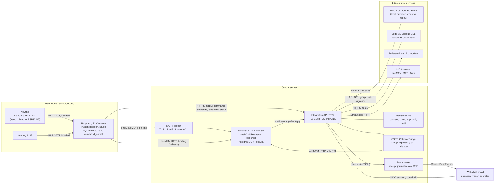
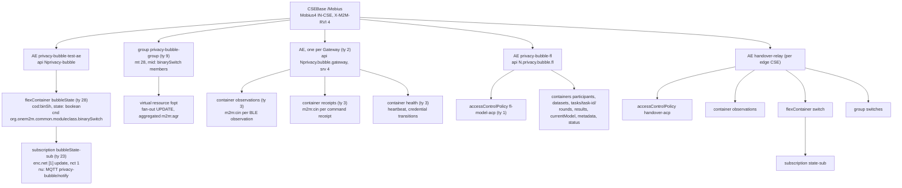
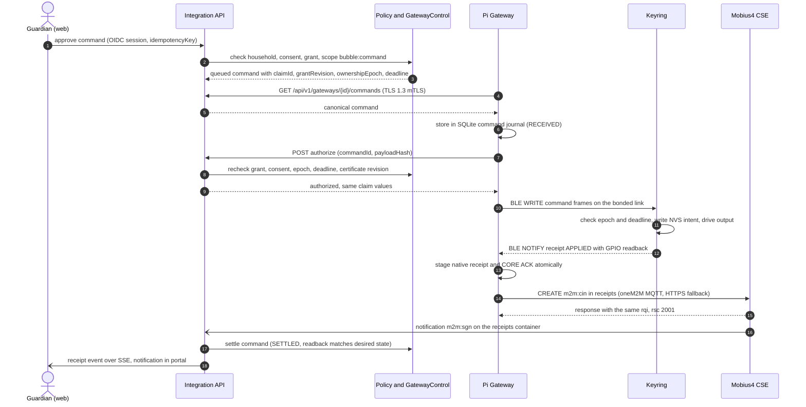
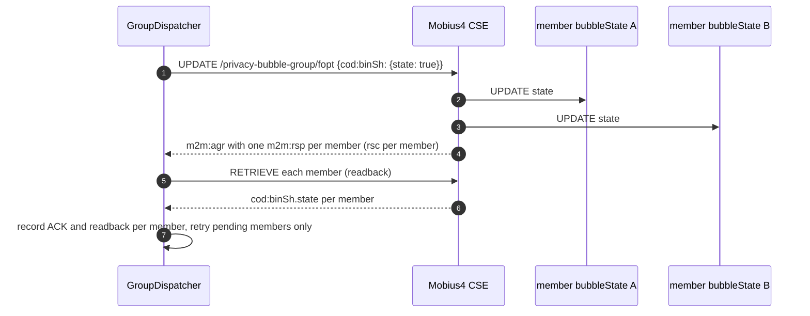

# Architecture

This page describes how the Privacy Bubble Keyring system is put together: the
devices, the oneM2M resources in the Mobius4 CSE, the command path with
acknowledgement and readback, and the protocol used on every segment. The
diagrams use Mermaid, which GitHub renders in the browser.

Related pages: [README](../README.md), [Why oneM2M](oneM2M-why.md),
[CORE oneM2M harness](../pc-mobius/README.md),
[Integration service](../pc-mobius/integration/README.md),
[Keyring and Gateway](../keyring/README.md).

## 1. System overview

The default demonstration path is
`Keyring BLE -> Raspberry Pi Gateway -> MQTT/HTTPS -> Mobius4 CSE -> web and app`.
Every resource that more than one application needs (device state, observations,
receipts, groups, subscriptions, access control) lives in the oneM2M CSE. The
central integration service adds consent, grants and approvals on top of it.

| Component | Role | Source |
|---|---|---|
| Keyring firmware | BLE observations (buttons, battery, motion, supply power), approved output commands, NVS command journal, device receipts | [keyring/firmware](../keyring/firmware/README.md) |
| Raspberry Pi Gateway | BLE scanning and bonding, durable SQLite outbox, oneM2M `m2m:cin` publishing over MQTT with HTTPS fallback, command authorization before every BLE write | [keyring/raspberry-pi-gateway](../keyring/raspberry-pi-gateway/README.md) |
| Mobius4 CSE | oneM2M resource store: AE, container, contentInstance, flexContainer, group, subscription, accessControlPolicy | external checkout, [IoTKETI/mobius4](https://github.com/IoTKETI/mobius4) |
| CORE harness | oneM2M contract runner, GatewayBridge (telemetry to flexContainer UPDATE, ACK binding), GroupDispatcher (fan-out per member), SDT adapter | [pc-mobius/src](../pc-mobius/src) |
| Integration service | API server, policy, portal, Gateway registration, MEC adapter, handover, FL, MCP, retention | [pc-mobius/integration/src](../pc-mobius/integration/src) |
| Web dashboard | Guardian and visitor portal, operator console, map with GPS/MEC pins and BLE range circles | [web-dashboard](../web-dashboard/README.md) |

## 2. oneM2M resource tree

The tree below combines the resources created by the CORE contract
([oneM2M-test-contract.v2.json](../pc-mobius/contracts/oneM2M-test-contract.v2.json)),
the Gateway configuration ([.env.example](../keyring/raspberry-pi-gateway/.env.example)),
Gateway registration, the federated learning publisher and the handover
coordinator. The Gateway AE name and the task container names are set per
deployment.

Notes:

- `cod:binSh` is the canonical Release 4 short name for the TS-0023 binarySwitch
  ModuleClass. The [SDT adapter](../pc-mobius/src/sdt-adapter.mjs) also reads and
  writes the `pb:binarySwitch`, `cod:binarySwitch` and `hd:binarySwitch`
  profiles so that clients and CSEs with older registries stay interoperable
  ([SDT notes](../pc-mobius/SDT.md)).
- Discovery uses `fu=1&ty=28&cnd=org.onem2m.common.moduleclass.binarySwitch`, so
  an application finds every switch by its device model, without a hard-coded
  path.
- The Gateway writes immutable `m2m:cin` children. The content instance name is
  derived from the request identifier, so an HTTPS retry after an MQTT timeout
  produces the same resource and the Gateway accepts a name conflict only when
  the stored payload matches.
- Precise location stays out of the CSE. A location `m2m:cin` carries an
  encrypted payload reference, its hash and an `et` expiry; the ciphertext stays
  in the policy store ([location privacy](../pc-mobius/integration/LOCATION_PRIVACY.md)).
- The ACP matrix test ([run-acp-real.mjs](../pc-mobius/scripts/run-acp-real.mjs))
  creates one AE per role (guardian, visitor, relay, mecIPE, executor, operator,
  policyDeployer) and gives each role the smallest `acop` mask it needs, for
  example RETRIEVE only on `desired` and CREATE plus UPDATE on `actual` for the
  MEC interworking role.

## 3. Command path with ACK and readback

A command changes a physical output (for example the vibration motor, or the
built-in LED on the Feather bench board). The central service issues a claim
that binds `commandId`, `claimId`, `grantRevision`, `ownershipEpoch`,
`deadline` and `payloadHash`. The Gateway, the keyring and the receipt carry
these values unchanged, and the command counts as done only after a readback
of the device output.

Failure handling follows the same identifiers:

- A timeout or restart during dispatch produces a `TIMEOUT` or `INDETERMINATE`
  receipt. The Gateway never repeats a physical action by itself; it only
  retries delivery of an existing receipt.
- A revoked grant, a lower epoch or an expired deadline produces a rejection
  receipt (for example `EXPIRED`) that still reaches the CSE and the dashboard.
- The Gateway blocks execution when the wall clock jumps more than 2 seconds
  against the monotonic clock, or when the credential status is stale.

### Group fan-out

For several keyrings at once, the GroupDispatcher sends one UPDATE to the
group's `fopt` virtual resource. Mobius4 fans the request out to every member
and returns one aggregated response. The dispatcher keeps one `commandId` per
member, so partial success and retries stay visible per keyring.

## 4. Protocol per segment

| Segment | Protocol and framing | Security | Standard | Implementation |
|---|---|---|---|---|
| Keyring and Pi Gateway | BLE GATT WRITE and NOTIFY, UTF-8 JSON plus LF, 20-byte fragments, 4096-byte frame limit, 512-byte observation limit | LE Secure Connections passkey bonding with MITM protection | Bluetooth Core | [firmware](../keyring/firmware/src), [ble.py](../keyring/raspberry-pi-gateway/src/bubble_gateway/ble.py) |
| Pi Gateway to CSE | oneM2M MQTT binding, MQTT 3.1.1, QoS 1, `/oneM2M/req/{originator}/{cseId}/json` | TLS 1.3, client certificate, per-CN topic ACL | oneM2M TS-0010 | [transport.py](../keyring/raspberry-pi-gateway/src/bubble_gateway/transport.py) |
| Pi Gateway to CSE (fallback) | oneM2M HTTP binding over HTTPS, `Content-Type: application/json;ty=4`, same `rqi` and `rn` | TLS 1.3, client certificate | oneM2M TS-0009 | [transport.py](../keyring/raspberry-pi-gateway/src/bubble_gateway/transport.py) |
| Pi Gateway and Integration API | HTTPS REST: `commands`, `authorize`, `credentials/status` under `/api/v1/gateways/{id}` | TLS 1.3, mTLS, certificate SHA-256 fingerprint bound to a registered principal | RFC 8446 | [api-server.mjs](../pc-mobius/integration/src/api-server.mjs) |
| Pi Gateway and CORE bridge (optional) | MQTT topics `privacy-bubble/gateway/{id}/telemetry`, `command`, `ack` | TLS, topic ACL | project contract | [gateway-bridge.mjs](../pc-mobius/src/gateway-bridge.mjs), [core_bridge.py](../keyring/raspberry-pi-gateway/src/bubble_gateway/core_bridge.py) |
| CORE and integration service to CSE | oneM2M primitives over HTTP or MQTT, `X-M2M-Origin`, `X-M2M-RI`, `X-M2M-RVI: 4` | ACP per originator | oneM2M TS-0001, TS-0004 | [pc-mobius/src](../pc-mobius/src), [handover-cse.mjs](../pc-mobius/integration/src/handover-cse.mjs) |
| CSE to subscribers | oneM2M notification `m2m:sgn` over HTTP or MQTT | NOTIFY right checked against the current ACP | oneM2M TS-0001, TS-0004 | Mobius4, [CSE security patch](../pc-mobius/integration/CSE_SECURITY.md) |
| Event server to browser | Server-Sent Events (`text/event-stream`) | OIDC session in the BFF (PKCE, state, nonce, HttpOnly cookie) | OpenID Connect Core | [web-dashboard/server](../web-dashboard/server) |
| Integration service and MEC | REST: service discovery, Location and RNIS queries, subscription CRUD, HTTP callbacks | registered provider principal, mTLS fingerprint, opaque callback token | ETSI GS MEC 011, 012, 013 | [mec-http-client.mjs](../pc-mobius/integration/src/mec-http-client.mjs), [MEC notes](../pc-mobius/integration/MEC.md) |
| Integration service and FL workers | HTTPS REST `/v1/fl/health`, `/v1/fl/train` | TLS 1.3 mTLS, Ed25519-signed model updates | project contract | [fl-worker.mjs](../pc-mobius/integration/src/fl-worker.mjs), [FL notes](../pc-mobius/integration/FL.md) |
| FL coordinator to CSE | oneM2M HTTP: AE, ACP, container, contentInstance with model bytes and manifest | dedicated ACP `fl-model-acp` | oneM2M TS-0004 | [fl-publisher.mjs](../pc-mobius/integration/src/fl-publisher.mjs) |
| Agent and MCP servers | MCP Streamable HTTP (JSON-RPC), protocol `2025-11-25`, `2025-06-18` negotiated | audience-bound tokens, approval hash per run | Model Context Protocol | [mcp-http.mjs](../pc-mobius/integration/src/mcp-http.mjs), [MCP notes](../pc-mobius/integration/MCP.md) |

The machine-readable contracts for these segments are in
[pc-mobius/contracts](../pc-mobius/contracts), [contracts/keyring](../contracts/keyring)
and [web-dashboard/contracts](../web-dashboard/contracts).

## 5. Edge handover

The handover coordinator moves an application between two CSEs (Edge-A and
Edge-B) without losing state. It prepares the target process, rechecks the
current policy, recreates the AE, ACP, group and subscription on the target,
copies the latest state, switches over, reads the state back and then releases
the source. Each step carries a handover epoch, so a late write to the old CSE
is fenced. The local test runs two real Mobius4 processes on one host
([handover-real-cse.json](verification-evidence/2026-11-11/handover-real-cse.json)).

## 6. Data protection by design

- Raw precise location is encrypted with AES-256-GCM in the policy store; the CSE
  holds only a reference, a hash and an expiry.
- Visitor access to a keyring location requires a guardian approval tied to an
  open incident, a purpose and a lease of at most 5 minutes.
- Consent revocation reaches the Gateway through the credential and grant
  revision checks before the next BLE write.
- Retention defaults: abstract data 7 days, detailed and pseudonymous data
  24 hours, audit and FL provenance 30 days
  ([retention](../pc-mobius/integration/RETENTION.md)).
- Certificates, private keys, passkeys, SQLite databases and runtime state stay
  in git-ignored paths such as `.local/`.
