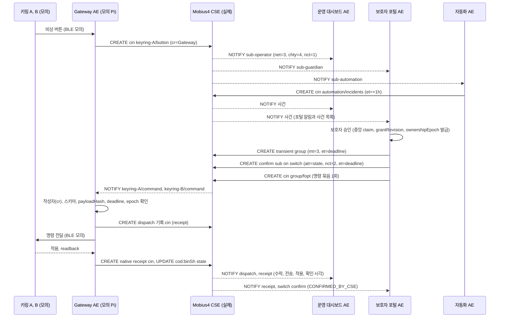

# R03 혁신 시나리오: 키링 사건을 CSE가 세 앱에 나눠 주는 흐름

키링 버튼 한 번이 실제 Mobius4 CSE를 거쳐 운영 대시보드, 보호자 포털, 자동화 앱에 동시에 전달되고, 보호자 승인 명령이 그룹 fan-out으로 두 키링에 적용된 뒤 확인까지 돌아오는 시나리오를 실제 CSE에서 19개 확인 항목 전부 통과로 기록함.

ROLE: WEB-DASHBOARD, PC-MOBIUS-CORE 협업 | DOC-REV 2.0.0 | RUBRIC: R03

## 범위

- 실제: Mobius4 4.24.5 CSE와 PostgreSQL, AE 4개, Gateway ACP 6개와 자동화 ACP 1개, 상시 subscription 24개와 transient subscription 2개, transient group, 알림 전달, la RETRIEVE, 라벨 discovery, web-dashboard 서버 프로세스, 자동화 AE 프로세스
- 모의(simulation true): Raspberry Pi Gateway 프로세스와 키링 2개(keyring-A, keyring-B), BLE GATT 쓰기 지연 35~70 ms
- Gateway 쓰기 경로는 `bubble_gateway.transport.TransportHub.publish`와 같은 방식(rn `gw-sha256(requestId)`, cnf `application/json:0`, 생성 뒤 RETRIEVE 대조)을 따르고, 관측과 명령 검증은 Pi daemon의 `bubble_gateway.model`(validate_observation, validate_command, payload_hash)을 Python 브리지로 그대로 호출함

## 시나리오 구성



앱 사이 연결은 CSE 알림만 사용함. 자동화 앱은 사건을 자기 incidents 컨테이너에 쓰고, 운영 대시보드와 보호자 포털은 그 컨테이너를 각자 구독함.

## 사용한 oneM2M 서비스 기능

| 기능 | 적용 위치 | 앱 코드 대신 맡은 일 |
| --- | --- | --- |
| subscription, eventNotificationCriteria | 모든 키링 컨테이너: net=3, chty=4, nct=1, nu=구독자 AE-ID(poa로 전달) | 한 번의 쓰기를 세 앱에 fan-out |
| attribute 조건과 modified attributes | 보호자 transient sub: enc.atr=[state], nct=2 | lbl 변경은 알림 제외, state 변경만 확인 알림 |
| group fanOutPoint | 보호자 transient group mt=3, fopt CREATE 1회로 명령 컨테이너 2개에 기록 | 앱의 기기별 반복 호출 대체 |
| expirationTime | 명령 cin, group, confirm sub의 et=명령 deadline, 사건 cin et=+1시간 | 일시 자원 수명 관리 |
| mni, mia | observation mni=100, button과 battery mni=20, command mni=20 mia=900, receipt mni=50 | 텔레메트리 링 버퍼와 명령 보관 기간 |
| la RETRIEVE, cra discovery | 대시보드 시작과 SSE 재연결 시 컨테이너별 la, 빈틈은 createdAfter discovery | 놓친 알림 복구 |
| discovery | lbl=pb-keyring 2건, ty=28 cnd=binarySwitch 2건 | 키링 자동 발견 |
| ACP, creator 속성 | 스트림별 ACP, 소비자 전부 cr 확인 | 최소 권한과 작성자 검증 |

## 앱별 AE와 ACP

| 앱 | 프로세스 | 구독 | 권한 (acop) |
| --- | --- | --- | --- |
| Gateway (모의) | pc-mobius/multiapp/gateway-emulator.mjs | command 2개 | 자기 자원 63 |
| 운영 대시보드 | web-dashboard/server/cli.ts, cse-live.ts | observation, button, battery, command, receipt 각 2개 + incidents | 스트림 35, 루트 34 |
| 보호자 포털 | 같은 서버의 별도 AE | button, battery, receipt 각 2개 + incidents + transient confirm 2개 | observation 0, 나머지 35 |
| 자동화 | pc-mobius/multiapp/automation-ae.mjs | button, battery 각 2개 | observation과 command 0, button과 battery 35, incidents 63 |

Mobius4 4.24.5는 subscription 생성을 부모 자원 CREATE로 판정하므로 구독자는 C+R+DISC(35)를 가짐. 이 쓰기 권한은 소비자 쪽 creator(cr) 확인으로 막음. 실제 CSE에서 운영 대시보드 AE가 만든 위조 명령은 CSE가 2001로 받았고 Gateway가 UNAUTHORIZED_WRITER로 거절했으며 keyring-B 상태는 그대로 유지됨.

ACP 실측 7건 전부 기대값과 일치함: 보호자 observation 조회 4103, 자동화 command 조회 4103, 자동화 observation 구독 4103, 운영 switch 수정 4103, 운영 button 삭제 4103, 보호자 button la 조회 허용, 운영 observation la 조회 2000.

## 결과

영수증: [docs/verification-evidence/2026-11-19/multiapp-real-cse.json](../verification-evidence/2026-11-19/multiapp-real-cse.json), 상태 PASS, 확인 항목 19/19.

| 구간 | 측정값 (ms, 단일 PC 루프백) |
| --- | --- |
| 버튼 CREATE 시작에서 운영 대시보드 SSE 도착 | 10 |
| 버튼 CREATE 시작에서 자동화 AE 알림 | 12 |
| 버튼 CREATE 시작에서 보호자 AE 알림 | 11 |
| 자동화 알림에서 사건 CREATE 완료 | 4 |
| 사건 CREATE에서 운영 SSE, 보호자 알림 | 1, 2 |
| 버튼에서 보호자 포털 사건 표시 | 41 |
| 승인 요청에서 두 키링 확인(대시보드 READBACK_VERIFIED) | 135, 151 |
| 자동 구간 합계 (사람 판단 시간 제외) | 192 |

- 대시보드 명령 타임라인은 두 키링 모두 수락, 전송, 적용, 확인 네 단계를 채우고 상태가 verified임
- claimId, grantRevision, ownershipEpoch, deadline, payloadHash가 Gateway 처리, dispatch 기록, ACK까지 두 키링 모두 같은 값으로 이어짐
- 운영 AE의 poa를 닫힌 포트로 바꾼 사이 생긴 관측 1건은 SSE 재연결 시 la RETRIEVE로 복구되어 다음 sequence로 전달됨
- 배터리 12% 관측은 자동화 AE의 MAINTENANCE 사건이 되어 보호자 포털에 표시됨
- deadline이 지난 뒤 같은 명령 묶음을 다시 fan-out하면 CSE는 2001로 받고 Gateway는 두 키링 모두 EXPIRED로 거절함

화면 기록: [operator-commands](../../web-dashboard/evidence/2026-11-19-live-cse/operator-commands-1440-light.png), [operator-overview](../../web-dashboard/evidence/2026-11-19-live-cse/operator-overview-1440-light.png), [user-activity](../../web-dashboard/evidence/2026-11-19-live-cse/user-activity-390-light.png). 기존 Calm Console 화면 그대로 실시간 CSE 데이터를 보여 줌.

## 실행 방법

```bash
export MOBIUS4_ROOT=<Mobius4 4.24.5 소스 경로>
npm --prefix web-dashboard run build          # 화면 기록을 함께 남길 때
node pc-mobius/scripts/run-multiapp-real.mjs --screenshot
```

대시보드만 실시간 원천으로 띄울 때는 `DASHBOARD_SOURCE=cse-live CSE_LIVE_CONFIG=<설정 JSON> npm --prefix web-dashboard run sse`를 씀. 기본값은 기존 fixture와 journal 재생임.

## 한계

- 키링과 Pi Gateway는 모의 장치임. 실물 BLE, 전파 거리, 전력은 keyring/evidence 영수증이 맡음
- 단일 PC 루프백 HTTP 구간임. MQTT와 HTTPS mTLS 바인딩은 다른 영수증이 맡음
- oneM2M creationTime 해상도가 1초라서 대시보드의 수락 시각은 초 단위로 잘림. ms 단위 구간은 영수증의 runner 측정값으로 남김
- 보호자 승인은 포털 데모 런타임이 중앙 claim을 발급함. native receipt의 중앙 정산은 기존 중앙 API 경로를 그대로 씀
- Mobius4 4.24.5는 et가 지난 group, cin, sub를 정리 주기(기본 1일) 전까지 RETRIEVE와 fopt에 계속 응답함. 만료 명령 차단은 Gateway의 deadline 확인이 맡음
- 보호자 포털의 CSE 사건 카드에 있는 처리 완료 버튼은 중앙 사건 저장소와 연결하는 작업이 다음 단계임
