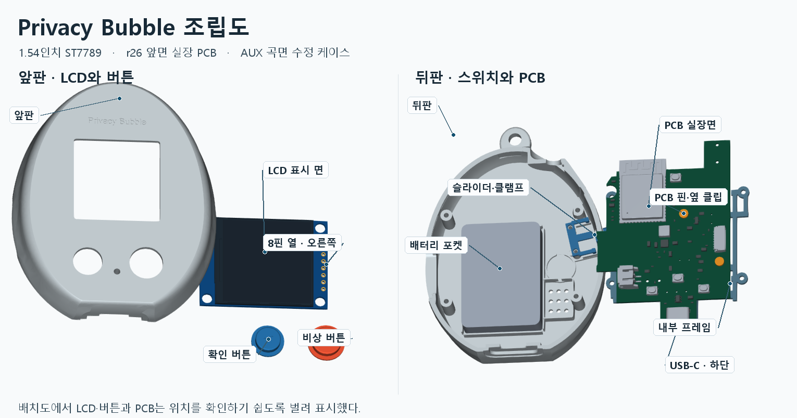
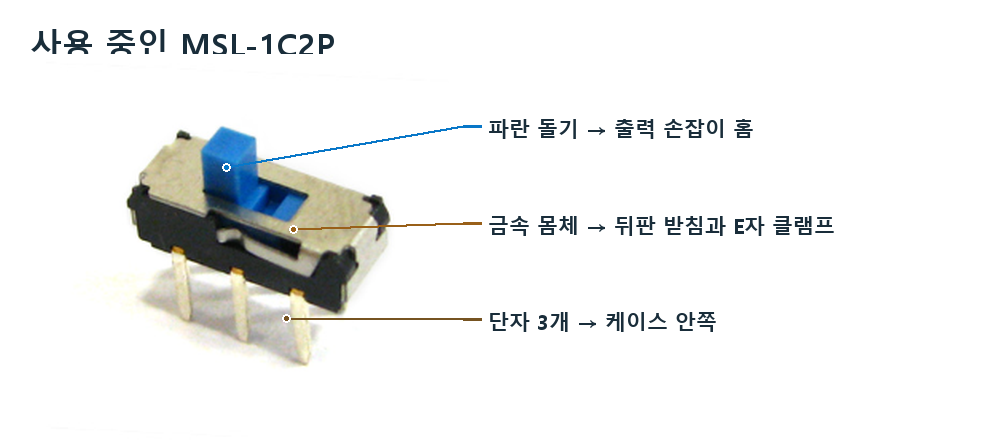
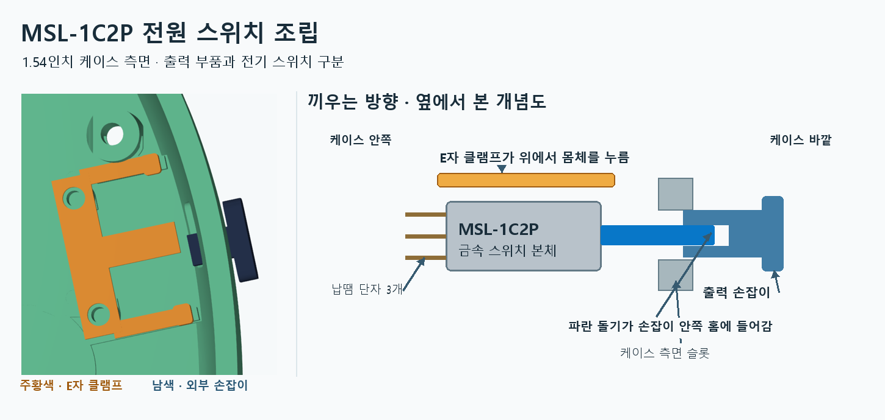
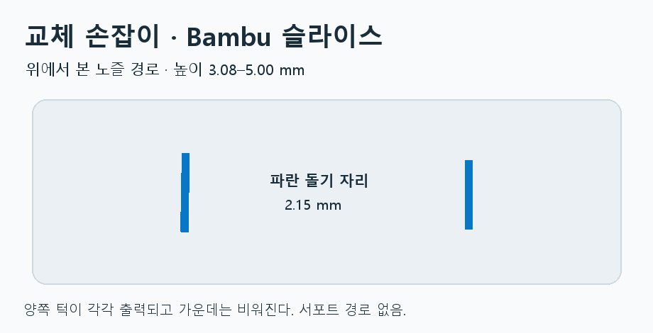

# Privacy Bubble 조립 가이드

1.54인치 ST7789 · AUX 곡면 수정 케이스 · r26 앞면 실장 보드

## 준비

- 처음부터 출력할 때는 [교체 손잡이가 적용된 전체 11부품 3MF](fork_full/Privacy_Bubble_154_P1S_PLA.3mf)를 사용한다. 케이스가 이미 있으면 [교체 손잡이 단품 3MF](switch_slider_reprint/Privacy_Bubble_154_P1S_PLA.3mf)만 출력한다. 케이스만 필요하면 [앞판·뒤판 전용 3MF](covers_only/Privacy_Bubble_154_P1S_PLA.3mf)를 사용한다.
- r26 앞면 실장 PCB, 1.54인치 ST7789, JST SH 8핀 하네스, MSL-1C2P 스위치, DTP803040 배터리, 얇은 폼 양면테이프를 준비한다.
- 슬라이드 클램프용 M1.6×5 접시머리 2개와 케이스 결합용 M1.6×18 나사 4개를 준비한다. 버튼 높이 조정용 M2 나일론 팁 나사 2개는 클릭이 닿지 않을 때 사용한다.

## 1. 커넥터와 스위치 배선

납땜 중에는 배터리와 USB를 모두 분리한다.

| 위치 | 연결 |
| --- | --- |
| J9.1 ON | 스위치를 ON 위치에 뒀을 때 COM과 도통되는 단자 |
| J9.2 COM | 스위치 공통 단자 |
| J9.3 OFF/GND | 2선으로 조립할 때 비워 둔다. 보드의 R43이 OFF에서 전원 EN을 내린다. |
| J2.1 / J2.2 | 배터리 + / −. 플러그를 꽂기 전에 실제 극성을 확인한다. |

J3는 아래 표대로 **LCD 실크와 PCB 핀 번호**를 맞춘다. 핀 번호는 PCB의 1번 표시를 기준으로 센다.

| LCD 실크 | r26 J3 | 신호 |
| --- | ---: | --- |
| GND | 2 | GND |
| VCC | 1 | 3.3 V |
| SCL | 4 | SPI SCK |
| SDA | 3 | SPI MOSI |
| RST | 7 | LCD 리셋 |
| DC | 6 | 데이터/명령 |
| CS | 5 | 칩 선택 |
| BL | 8 | 백라이트 |

## 2. 뒤판 조립

1. 출력한 `switch_slider`의 넓은 면이 케이스 바깥에 오도록 뒤판 측면 슬롯에 끼운다. 안쪽에서 실물 스위치의 **파란 사각 돌기가 있는 금속 면을 케이스 옆벽 쪽**으로 돌려 몸체를 받침에 놓는다. 파란 돌기는 교체 손잡이의 두 턱 사이에 끼운다. 납땜 단자 3개는 케이스 중앙 쪽을 향한다.
2. 출력한 E자 `switch_clamp`를 금속 몸체 위에 올려 M1.6×5 접시머리 나사 2개로 고정한다. 외부 손잡이를 양끝까지 움직여 파란 돌기도 함께 움직이는지 확인한다.
3. 배터리를 뒤판 포켓에 놓고 흔들리지 않게 고정한다. 커넥터는 열린 상태로 둔다. 전선을 케이스 접합면과 나사 기둥에서 치운다.
4. `midframe_common`을 올리고 PCB의 **부품 실장면이 앞판을 향하게** 놓는다. USB-C를 하단 개구부에 먼저 맞춘다. PCB 홀 두 곳에 위에서 `pcb_pin`을 넣고, 프레임 옆 슬롯에서 `pcb_latch`를 핀의 좁은 목에 밀어 끼운다.

## 3. 앞판 조립

1. 앞판 **안쪽**에서 작은 ✓ 버튼은 정면 기준 왼쪽, 큰 ! 버튼은 오른쪽에 넣는다. 캡 머리는 바깥으로, 누름봉은 PCB 쪽으로 향한다. 원형 턱이 앞판 안쪽에 걸린다.
2. LCD 표시 면을 앞판 창 바깥쪽으로 향하게 놓는다. 고리를 위로 놓고 정면에서 보면 **8핀 열은 오른쪽, BL은 위, GND는 아래**다. 창에 표시 영역을 먼저 맞춘 뒤 얇은 폼 양면테이프로 모듈 가장자리만 고정한다.
3. LCD 하네스를 J3에 꽂는다. 앞판을 시험 결합하면서 두 버튼이 각각 클릭하고 손을 떼면 돌아오는지 본다. 필요하면 버튼 안쪽의 M2 나일론 팁을 조금씩 올려 클릭 높이를 맞춘다. 손을 뗀 상태에서는 택트 스위치가 해제되어 있어야 한다.

## 4. 케이스 닫기 전 확인

1. J2에 배터리를 꽂고 슬라이더를 ON으로 옮긴다. 화면을 확인하고 ✓와 !를 각각 눌러 동작을 본다. ON/OFF를 한 번 왕복해 화면이 꺼지고 다시 부팅되는지 확인한다.
2. USB-C 데이터 케이블을 꽂아 플러그가 끝까지 들어가는지 확인한다. PC 연결 확인이 필요하면 배터리를 연결하고 슬라이더를 ON으로 둔다. **r26 앞면 실장 시연 보드는 배터리를 외부 1셀 충전기로 충전한다.** AUX 잭이 미실장이면 상단 홈은 케이스 형상 확인에만 사용한다.
3. 배터리·LCD·스위치 선이 앞뒤판 접합면에 끼이지 않도록 정리한다. 나사 없이 앞뒤판이 밀착되는지 확인한 뒤 뒤판에서 M1.6×18 나사 4개를 대각선 순으로 가볍게 조인다. 조인 뒤 버튼 복귀와 슬라이더 이동을 다시 확인한다.
