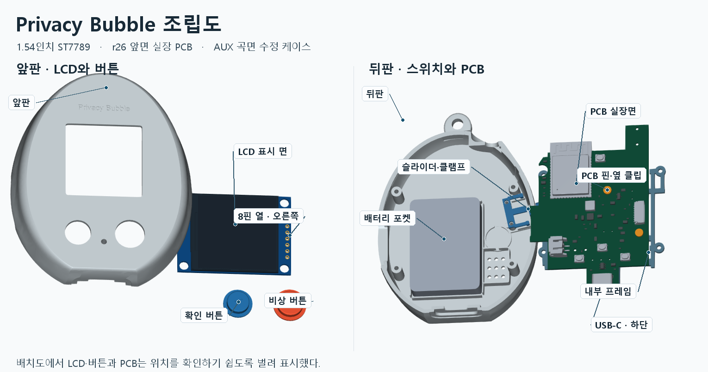
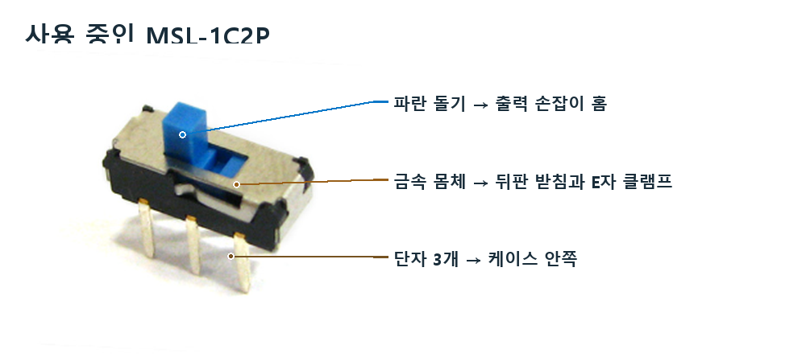
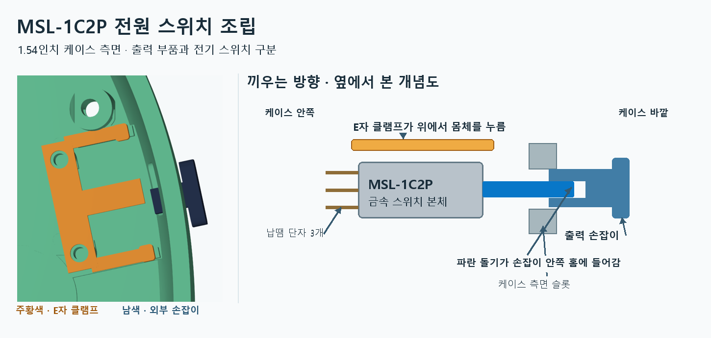

# Keyring case for r26: print and assembly guide

A 3D-printed case for the r26 front-side assembly board with a 1.54 inch ST7789 LCD, revised with a curved AUX side. The hardware author's original guide (Korean) is in [ASSEMBLY_GUIDE.ko.md](ASSEMBLY_GUIDE.ko.md). The board is in [keyring/pcb/r26](../../pcb/r26/README.md).

## Files

| File | Use |
|---|---|
| [`fork_full/Privacy_Bubble_154_P1S_PLA.3mf`](fork_full/Privacy_Bubble_154_P1S_PLA.3mf) | All 11 parts with the replacement slider, sliced for a Bambu Lab P1S (PLA, 0.4 mm nozzle, 0.16 mm layers). Start here for a new build. |
| [`covers_only/Privacy_Bubble_154_P1S_PLA.3mf`](covers_only/Privacy_Bubble_154_P1S_PLA.3mf) | Front and back covers only |
| [`switch_slider_reprint/`](switch_slider_reprint/) | Replacement slider only: 3MF, STEP, STL and the toolpath preview |
| `case_front.step`, `case_back.step`, `case_front.stl`, `case_back.stl` | Covers for other printers and CAD tools |
| `r26_clearance.json` | Clearance check between the covers, the board and the parts |

## What you need

- r26 front-side assembly PCB, 1.54 inch ST7789 LCD module, JST SH 8-pin harness
- MSL-1C2P slide switch, DTP803040 battery, thin double-sided foam tape
- Two M1.6x5 countersunk screws (switch clamp) and four M1.6x18 screws (case)
- Optional: two M2 nylon-tip screws to raise the buttons if a click does not reach the switch

## 1. Wire the connectors and the switch

Unplug the battery and USB while soldering.

| Position | Connect to |
|---|---|
| J9.1 ON | The switch terminal that connects to COM in the ON position |
| J9.2 COM | The switch common terminal |
| J9.3 OFF/GND | Leave open for a two-wire switch; R43 on the board pulls the power enable low in OFF |
| J2.1 / J2.2 | Battery + / -. Check the real polarity before plugging in. |

Match the LCD silkscreen labels to the J3 pin numbers, counting from the pin 1 mark on the PCB:

| LCD label | r26 J3 | Signal |
|---|---:|---|
| GND | 2 | GND |
| VCC | 1 | 3.3 V |
| SCL | 4 | SPI SCK |
| SDA | 3 | SPI MOSI |
| RST | 7 | LCD reset |
| DC | 6 | Data/command |
| CS | 5 | Chip select |
| BL | 8 | Backlight |

## 2. Back cover

1. Fit the printed `switch_slider` into the side slot of the back cover with its wide face outside. From the inside, place the switch body on its seat with the metal face carrying the blue square tab towards the side wall. The blue tab sits between the two jaws of the slider, and the three solder terminals point to the center of the case.
2. Put the printed E-shaped `switch_clamp` on the metal body and fix it with two M1.6x5 countersunk screws. Move the outside slider end to end and check that the blue tab moves with it.
3. Place the battery in its pocket so that it stays put, leave the connector open, and keep the wires away from the cover seam and the screw posts.
4. Put `midframe_common` on top and lay the PCB with its components facing the front cover. Align USB-C with the bottom opening first. Push a `pcb_pin` through each of the two PCB holes from above, then slide a `pcb_latch` from the side slot of the frame into the narrow neck of each pin.

## 3. Front cover

1. From the inside of the front cover, insert the small check-mark button on the left and the large ! button on the right, seen from the front. Cap heads go outside, plungers face the PCB, and the round collar rests on the inside of the cover.
2. Place the LCD with its display face towards the window. With the loop at the top, the 8-pin row is on the right, BL at the top and GND at the bottom. Align the active area with the window first, then fix only the module edges with thin foam tape.
3. Plug the LCD harness into J3. Test-fit the front cover and check that each button clicks and springs back. If needed, raise the click height step by step with the M2 nylon-tip screws inside the buttons. With the buttons released, the tact switches must be open.

## 4. Before closing the case

1. Plug the battery into J2 and move the slider to ON. Check the screen and press the check-mark and ! buttons. Move the switch OFF and ON once and check that the screen turns off and boots again.
2. Plug in a USB-C data cable and check that it goes all the way in. To check the PC connection, connect the battery and leave the slider on ON. The r26 front-side demo board charges its battery in an external 1-cell charger. When the AUX jack is unpopulated, the top groove only checks the case shape.
3. Route the battery, LCD and switch wires clear of the seam. Check that the covers close flat without screws, then tighten the four M1.6x18 screws lightly from the back, crosswise. Check button return and slider travel once more.

## License

The case design files in this folder: CC BY 4.0 ([LICENSE-docs](../../../LICENSE-docs)).
