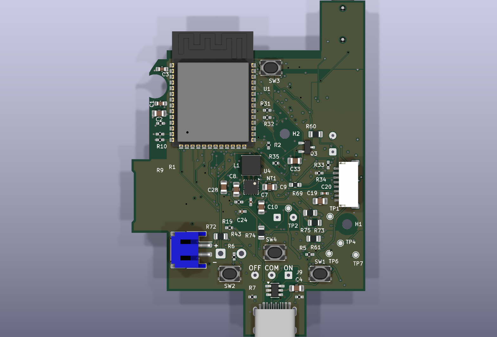
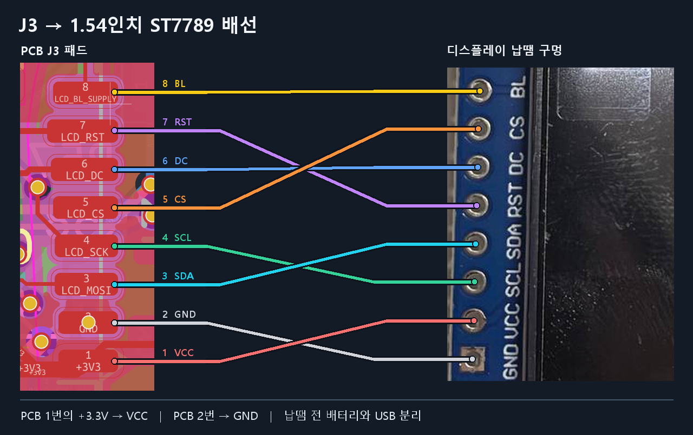

# Keyring PCB r26 (front-side assembly)

r26 is the board revision inside the demo keyrings of Privacy Bubble Keyring. It is a 4-layer, 1.0 mm board around an ESP32-S3-WROOM-1 module, derived from r25 with one change: R71 is removed and the LCD data/command line is routed directly. For the 2026 oneM2M International Hackathon we ordered 5 boards and had 2 of them factory-assembled on the top side only.

The hardware author's original notes (Korean) are in [README.ko.md](README.ko.md). The case and its assembly guide are in [keyring/case/r26](../../case/r26/README.md).

## What is on the demo boards

| Item | Value |
|---|---|
| Stackup | 4 copper layers, 1.0 mm, standard 0.3 mm vias |
| Top side | 47 parts in 25 BOM lines, all placed by the factory; 0 hand-soldered parts, 0 jumper wires |
| Back side | 89 optional parts left unpopulated ([DNP_LIST.csv](assembly/DNP_LIST.csv)) |
| r26 change | R71 symbol, footprint and silkscreen removed; LCD_DC runs from GPIO8 (U1 pad 12) to J3 pin 6 on a 0.15 mm top-layer trace, with 0 extra vias |
| Kept from r25 | Placement, power loops, decoupling, board outline, case mounting holes and port positions |
| Checks (hardware author, KiCad 10.0.3) | DRC 0, ERC 0, unconnected 0, schematic parity 0 ([validation_summary.json](checks/validation_summary.json)) |

### Four 0-ohm bypass resistors

R72 to R75 are YAGEO RC0805JR-070RL (LCSC C96345, 0805), four per board. They let the front-side build run without the back-side power circuits.

| Resistor | Connects | Bypasses |
|---|---|---|
| R72 | VBAT to SYS_LIMIT | U3 charge and power path, U11 main switch |
| R73 | VBAT to PWR_SW (slide switch ON) | U10 undervoltage control |
| R74 | REG_EN (slide switch COM) to REG_READY (U4 EN) | U17 supply supervisor |
| R75 | +3V3 to AUX3V3 | U13 auxiliary power switch |

To populate a back-side circuit, first remove the bypass resistor that covers it. A full back-side build removes all four ([BYPASS_CONFIGURATION.csv](assembly/BYPASS_CONFIGURATION.csv)).

### Connections used by the demo firmware

| Function | Pins |
|---|---|
| Battery | J2 (check polarity first); DTP803040 1000 mAh, charged in an external 1-cell charger. USB-C charging, temperature and undervoltage circuits stay idle on this build, and USB-C carries ESP32 USB data. |
| Power switch | J9.1 ON, J9.2 COM, J9.3 OFF/GND |
| LCD (1.54 inch 240x240 ST7789) | MOSI GPIO38, SCK GPIO39, CS GPIO18, DC GPIO8, RESET GPIO43, backlight GPIO2 (HIGH off, LOW on) |
| Buttons | Confirm GPIO6, PANIC GPIO7, LOW when pressed |
| USB | D- GPIO19, D+ GPIO20, USB console. UART0 TX logging stays off because GPIO43 is the LCD reset. |
| Idle in the demo firmware | Audio, sensors, microSD, fuel gauge and the MAIN/AUX FAULT logic |

LCD harness (JST SH 8-pin) from the module labels to J3:

| LCD label | GND | VCC | SCL | SDA | RST | DC | CS | BL |
|---|---|---|---|---|---|---|---|---|
| r26 J3 pin | 2 | 1 | 4 | 3 | 7 | 6 | 5 | 8 |

Firmware build profiles, first power-on and over-the-air updates: [R26_BRING_UP.md](../R26_BRING_UP.md) and [R26_OTA.md](../../firmware/R26_OTA.md).

## Files

| Path | Contents |
|---|---|
| `privacy_bubble.kicad_pro`, `.kicad_sch`, `.kicad_pcb`, `.kicad_dru`, `fp-lib-table`, `sym-lib-table`, `Release.kicad_sym` | KiCad 10 project |
| `Sourced_4L.pretty/`, `Sourced.pretty/`, `HandSolder.pretty/`, `3dmodels/`, `sourced_cad/` | Footprints and 3D models; third-party terms in [NOTICE](../../../NOTICE) |
| [`fabrication/privacy_bubble_r26_4L_front_assembly_gerber_drill.zip`](fabrication/privacy_bubble_r26_4L_front_assembly_gerber_drill.zip) | Gerber and drill: 4 copper layers, masks and silkscreens on both sides, outline, top paste, PTH and NPTH drill |
| [`assembly/BOM_JLCPCB.csv`](assembly/BOM_JLCPCB.csv), [`assembly/CPL_JLCPCB.csv`](assembly/CPL_JLCPCB.csv) | Top-side assembly files with LCSC part numbers; quantities are per board |
| [`assembly/POPULATION_BY_REFERENCE.csv`](assembly/POPULATION_BY_REFERENCE.csv) | Populated or unpopulated, per reference |
| [`assembly/FIRMWARE_PIN_MAP.csv`](assembly/FIRMWARE_PIN_MAP.csv) | ESP32-S3 pads, nets and GPIOs used by the r26 firmware |
| `checks/validation_summary.json`, `drc_final.json`, `erc_final.json` | Hardware author's checks, KiCad 10.0.3 |
| `checks/drc_r26_label_2026-11-20.json`, `erc_r26_label_2026-11-20.json` | Re-run after the label update below, KiCad 10.0.4 |
| [`3d/r26_top_assembly.step`](3d/r26_top_assembly.step) | Board as assembled (top side) |
| [`3d/r26_aux_optional.step`](3d/r26_aux_optional.step) | Board with the optional AUX parts, for enclosure checks |
| [`exports/r26-schematic.pdf`](exports/r26-schematic.pdf) | Schematic |
| [`exports/r26-board-top.png`](exports/r26-board-top.png) | Top-side render |
| [`exports/r26-board-bottom-full-design.png`](exports/r26-board-bottom-full-design.png) | Bottom render of the full design; on the demo boards these 89 back-side parts stay unpopulated |

A KiCad XML netlist is easy to regenerate with `kicad-cli sch export netlist --format kicadxml privacy_bubble.kicad_sch`; it records the absolute path of the machine that exports it, so the repository leaves it out.

## Label update on 2026-11-20

The title blocks still named older revisions, so we changed three text fields to r26. Circuits, footprints, copper, masks, silkscreen and drill data stay the same, and the Gerber zip is the hardware author's original.

| File | Field | Before | After |
|---|---|---|---|
| `privacy_bubble.kicad_pcb` | title block rev | r19 / standard vias | r26 / direct LCD DC, front-side assembly |
| `privacy_bubble.kicad_sch` | title block rev | r17 edge ports / two-layer layout in progress | r26 / direct LCD DC, front-side assembly |
| `privacy_bubble.kicad_sch` | comment 1 | R16/R17/J8 removed; D2/R18 retained; 3D views updated | R71 removed; LCD_DC wired directly from GPIO8 to J3.6 |

| File | SHA-256 before (equal to validation_summary.json) | SHA-256 after |
|---|---|---|
| `privacy_bubble.kicad_pcb` | `3c408eef457f7f8830f5e8cf06486eea775e83996467143cab9025f8d674c1ef` | `2f1782920fe6bb1137ad30dc8b9f60af697f21621363e861de8cd5ab4229f0f4` |
| `privacy_bubble.kicad_sch` | `325c5987df2d07763a71aed6f76833c1f18a5b041ecb8c4495e2a1bf22ffe083` | `cce052aa005f6ac1cde41344dfae172f60b53c5b6fa131db039f051e661b30e7` |

Re-run with `kicad-cli` 10.0.4, errors and warnings included: DRC 0 violations and 0 unconnected items, ERC 0 violations.

## Build one

1. Order the board from the Gerber zip (4 layers, 1.0 mm) with top-side assembly from the BOM and CPL.
2. Print and assemble the case: [keyring/case/r26](../../case/r26/README.md).
3. Flash `keyring_r26_front_st7789` and pair the keyring with the Raspberry Pi Gateway: [R26_BRING_UP.md](../R26_BRING_UP.md).

## License

Project-authored design files in this folder: CC BY 4.0 ([LICENSE-docs](../../../LICENSE-docs)). KiCad library parts and supplier models keep their own terms ([NOTICE](../../../NOTICE)).
